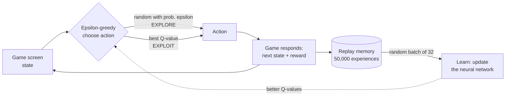

<div align="center">

# 🍄 Mario-Playing AI using Double Deep Q-Networks

**An AI that learns to play Super Mario Bros from raw pixels, by trial and error. No rules given.**


</div>

## 🎯 What is this?

The agent sees only the game screen and chooses between two actions (*walk right* or *jump right*). It gets a reward for moving right and a penalty for dying, and over **3,000 attempts** it teaches itself to play. This is **reinforcement learning**, the same family of methods behind game-playing AIs like AlphaGo.

Based on the [PyTorch Mario tutorial](https://docs.pytorch.org/tutorials/intermediate/mario_rl_tutorial.html). I rebuilt it as a clean multi-file project, fixed it to run on current Colab, and tuned the training schedule.

## 📊 Results

| Metric | Value |
|---|---|
| Training | 3,000 episodes, ~474k steps, ~94 min on a free T4 GPU |
| Learning signal | Q-value rose from **0 to ~48** (network learned to predict future reward) |
| Mean reward | ~600 at start, peak **~811** around episode 2,300 |
| Best test run | Reached **x = 1,409** (about 2x the other test runs, which stopped near x = 691) |
| Finished the level? | **No.** Needs far more training (the tutorial suggests 40,000+ episodes) |


## 🧠 How it works



1. **See:** each frame is shrunk to 84x84 grayscale, and 4 frames are stacked so the network can sense motion.
2. **Think:** a small CNN outputs a Q-value (expected future reward) for each action.
3. **Explore vs. exploit:** epsilon-greedy policy, decaying from 100% random to 10% random.
4. **Remember:** experiences are stored in a replay memory and learned from in random batches of 32.
5. **Learn (the "Double" part):** the *online* network **chooses** the next action and a frozen *target* network **scores** it. This avoids the over-optimistic estimates of plain DQN and keeps training stable.

```python
best_action = argmax(online_net(next_state))                 # online PICKS
td_target = reward + gamma * target_net(next_state)[best_action]   # target EVALUATES
```

## 🧗 Problems I solved

- **Tutorial code broke on current Colab (Python 3.13):** its pinned `torchrl`/`tensordict` versions don't exist anymore, and `gym` vs `gymnasium` clashed. I replaced the replay buffer with a plain `deque` and wrote my own environment wrappers.
- **Exploration schedule was too slow:** with the tutorial's epsilon decay, Mario was still 97% random after 560 episodes. I recalculated the decay so epsilon reaches 0.1 at ~64% of the run, and confirmed it in the logs.
- **Memory limits:** stored frames as `uint8` and capped the replay memory at 50,000 experiences to fit Colab's RAM.

## 📁 Project structure

| File | Purpose |
|---|---|
| `agent.py` | Mario agent: action choice, Double DQN learning, training loop |
| `dqn.py` | Neural network (online + target copies) |
| `mario_env.py` | Game environment and preprocessing |
| `experience_replay.py` | Replay memory |
| `evaluate_model.py` | Plays with a saved model and records a GIF |
| `parameters.yaml` | All hyperparameters in one place |

## ▶️ Run it

```bash
pip install -r requirements.txt
python agent.py             # train (GPU recommended)
python evaluate_model.py    # watch the trained agent, saves mario_play.gif
```
Edit `parameters.yaml` to change episodes, learning rate, or epsilon decay.

## 🚀 Future work
Train much longer, add Dueling networks and Prioritized Replay, and evaluate over more episodes and several random seeds.

---

<div align="center">

**Built by Krish** · Reinforcement Learning · PyTorch

</div>
