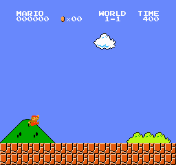
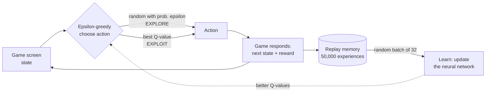
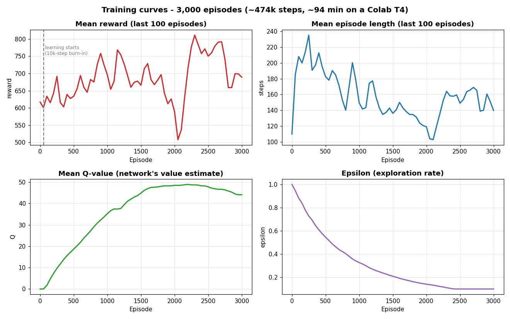

[README.md](https://github.com/user-attachments/files/33904302/README.md)
<div align="center">

# 🍄 Teaching an AI to Play Super Mario Bros

### A Double Deep Q-Network (DDQN) agent that learns from raw screen pixels, with no rules given




*The trained agent playing World 1-1. Nobody told it the rules: it learned by trial and error.*

</div>

---

## 📖 Table of contents
1. [The project in 30 seconds](#-the-project-in-30-seconds)
2. [Reinforcement learning explained simply](#-reinforcement-learning-explained-simply)
3. [How the agent works](#-how-the-agent-works)
4. [What makes it "Double" DQN](#-what-makes-it-double-dqn)
5. [Project structure](#-project-structure)
6. [Hyperparameters](#-hyperparameters)
7. [Results](#-results)
8. [Challenges I solved](#-challenges-i-solved)
9. [Limitations and future work](#-limitations-and-future-work)
10. [How to run it](#-how-to-run-it)
11. [Glossary](#-glossary)
12. [Tech stack and references](#-tech-stack-and-references)

---

## ⚡ The project in 30 seconds

| | |
|---|---|
| **Goal** | Make an AI play Super Mario Bros (World 1-1) by itself |
| **Method** | Reinforcement Learning with a **Double Deep Q-Network (DDQN)** |
| **Input** | Only the game screen (pixels), as a human would see it |
| **Output** | One of 2 actions: *walk right* or *jump right* |
| **Training** | 3,000 episodes, about 474,000 game steps, about 94 minutes on a free Colab T4 GPU |
| **Framework** | PyTorch |
| **Result** | The agent learned to run right and get past early obstacles, reaching about 1,400 pixels into the level in its best test run. It did **not** finish the level (see [Results](#-results) for an honest breakdown). |

This project is based on the official PyTorch tutorial [*Train a Mario-playing RL Agent*](https://docs.pytorch.org/tutorials/intermediate/mario_rl_tutorial.html). I rebuilt it as a clean multi-file project, made it run on current Google Colab (Python 3.13), and tuned the training schedule for a realistic compute budget.

---

## 🧠 Reinforcement learning explained simply

Imagine teaching a dog a trick. You don't explain the trick. The dog tries things, and you give a treat when it does something right. Over time it learns which actions lead to treats.

Reinforcement learning (RL) works the same way:

| Dog training | This project |
|---|---|
| The dog | The **agent** (Mario's "brain", a neural network) |
| The room | The **environment** (the Super Mario Bros game) |
| What the dog sees | The **state** (the last 4 screen frames) |
| What the dog does | The **action** (walk right or jump right) |
| The treat | The **reward** (the game score signal) |

**The reward:** the game gives positive reward for moving right (and quickly), and a penalty for losing time or dying. The agent's only goal is to collect as much reward as possible, so it has to discover *by itself* that moving right, jumping over enemies and avoiding pits is the way to do it.

**One *episode*** = one attempt at the level, from the start until Mario dies or reaches the flag. Mario plays thousands of episodes, getting a little better from each.

---

## 🔧 How the agent works

### The training loop



### Step 1: Seeing the game (preprocessing, in `mario_env.py`)

A raw game frame is 240 x 256 pixels in color (184,320 numbers), mostly irrelevant detail like the color of the sky. We shrink it step by step:

| Step | What it does | Why | Shape |
|---|---|---|---|
| Raw frame | Color screenshot | - | 240 x 256 x 3 |
| **Frame skip (4)** | Repeat each action for 4 frames and add up the rewards | Neighbouring frames look almost identical, so this makes training about 4x faster | same |
| **Grayscale** | Remove color | Color doesn't matter for playing | 240 x 256 |
| **Resize** | Shrink the image | Smaller input means faster, easier learning | 84 x 84 |
| **Frame stack (4)** | Stack the last 4 frames together | A single picture can't show motion. Four frames show whether Mario is rising, falling or moving | **4 x 84 x 84** |

Pixels are stored as small integers (`uint8`), which makes the replay memory 4x smaller than floating-point numbers.

### Step 2: Thinking (the neural network, in `dqn.py`)

The network is a small **convolutional neural network (CNN)**, the same type used for image recognition:

```
Input (4 x 84 x 84)
   -> Conv 32 filters (8x8, stride 4) -> ReLU
   -> Conv 64 filters (4x4, stride 2) -> ReLU
   -> Conv 64 filters (3x3, stride 1) -> ReLU
   -> Flatten (3,136 numbers)
   -> Dense 512 -> ReLU
   -> Dense 2          <- one Q-value per action
```

About **1.69 million parameters** per network. The output is a **Q-value** for each action: the network's estimate of "how much total future reward will I get if I take this action now?". Mario picks the action with the highest Q-value.

### Step 3: Exploring vs exploiting (`act` in `agent.py`)

If Mario always did what he *currently* believes is best, he'd never discover better moves. So he uses an **epsilon-greedy** policy:

- With probability **epsilon**, take a **random** action (explore).
- Otherwise take the **best known** action (exploit).

Epsilon starts at **1.0** (100% random) and decays to **0.1** (10% random) as training progresses, so Mario goes from curious to confident.

### Step 4: Remembering (`experience_replay.py`)

Every step, the agent stores an experience `(state, next_state, action, reward, done)` in a memory of 50,000 slots. When learning, it samples a **random batch of 32** past experiences. Random sampling matters because consecutive frames are highly similar, and learning from them in order would make training unstable.

### Step 5: Learning (`learn` in `agent.py`)

For each sampled experience the agent compares two numbers:

- **TD estimate**: what the network *currently predicts* for the action that was taken.
- **TD target**: what it *should* have predicted, `reward + gamma x (value of the next state)`.

The gap between them is the **loss**. Backpropagation (with the Adam optimizer) shrinks the gap, so predictions get closer to reality each time.

---

## ✌️ What makes it "Double" DQN

A plain DQN uses one network to both **choose** the best next action and **score** it. That tends to be over-optimistic, because it keeps picking actions whose value happens to be overestimated by noise.

**Double DQN splits the two jobs between two networks:**

| Network | Job | Updated by |
|---|---|---|
| **Online** network | **Chooses** the best next action | Gradient descent (every 3 steps) |
| **Target** network | **Evaluates** that action's value | Copied from the online net every 10,000 steps (frozen in between) |

```python
# from agent.py
best_action = torch.argmax(self.net(next_state, model="online"), dim=1)      # online PICKS
next_Q = self.net(next_state, model="target")[idx, best_action]               # target EVALUATES
td_target = reward + (1 - done) * gamma * next_Q
```

The frozen target also stops the learning goal from shifting at every single step, like trying to hit a target that keeps moving. This makes training much more stable. `(1 - done)` removes the future term when the game ends, because there is no future after death.

---

## 📁 Project structure

```
mario-ddqn/
├── parameters.yaml        # All hyperparameters in one place
├── mario_env.py           # Game environment + preprocessing wrappers
├── dqn.py                 # MarioNet: online and target neural networks
├── experience_replay.py   # Replay memory
├── agent.py               # Mario agent (act / learn / Double DQN) + training loop
├── evaluate_model.py      # Load a checkpoint, play, and save a GIF
├── requirements.txt       # Python dependencies
├── mario_play.gif         # Trained agent playing
├── training_curves.png    # Training plots
└── README.md
```

| File | Responsibility |
|---|---|
| `parameters.yaml` | Change episodes, learning rate, epsilon decay and more without touching code |
| `mario_env.py` | Builds the game and applies frame skip, grayscale, resize and frame stacking |
| `dqn.py` | Defines the CNN with its online and target copies |
| `experience_replay.py` | Stores experiences and samples random training batches |
| `agent.py` | Epsilon-greedy action choice, Double DQN maths, checkpointing, training loop |
| `evaluate_model.py` | Plays with a saved model (epsilon 0.05) and records a GIF |

Splitting the project this way means each file does one job, so it's easier to read, test and change.

---

## ⚙️ Hyperparameters

Defined in [`parameters.yaml`](parameters.yaml).

| Parameter | Value | Meaning |
|---|---|---|
| `episodes` | 3000 | Number of game attempts |
| `skip` | 4 | Frames each action is repeated for |
| `gamma` | 0.9 | Discount factor: how much future rewards count compared with immediate ones |
| `lr` | 0.00025 | Learning rate (Adam optimizer) |
| `batch_size` | 32 | Experiences per learning update |
| `memory_size` | 50,000 | Replay memory capacity |
| `burnin` | 10,000 | Steps collected before learning starts |
| `learn_every` | 3 | Learn once every 3 steps |
| `sync_every` | 10,000 | Steps between copying online weights into the target network |
| `eps_start` / `eps_min` | 1.0 / 0.1 | Epsilon range |
| `eps_decay` | 0.999994 | Epsilon multiplier per step (reaches 0.1 after about 384,000 steps) |
| Loss function | SmoothL1 | Behaves like squared error for small gaps and absolute error for big ones, so outliers don't wreck training |

---

## 📊 Results

### Training curves



How to read the plots:

- **Epsilon** fell smoothly from 1.0 to 0.1 and held there from about episode 2,400, so the last part of training used what Mario had learned.
- **Q-value** rose from 0 to about 48, then levelled off. The network learned to *predict* future reward, which is the signal that learning is working.
- **Reward and episode length** are noisy, with a peak mean reward of about **811** around episode 2,300 compared with about **600 to 620** at the start. Single-run RL results fluctuate a lot, and these curves are averaged over a window of the last 100 episodes.
- Episode length dropped from about 200 to about 140 to 165 steps. Mario became more decisive, but he also dies sooner, so a shorter episode isn't automatically better.

Sample points from the training log (mean over the previous 100 episodes):

| Episode | Steps so far | Epsilon | Mean reward | Mean Q |
|---|---|---|---|---|
| 0 | 110 | 0.999 | 617 | 0.0 |
| 500 | 100,971 | 0.546 | 634 | 18.7 |
| 1,000 | 186,141 | 0.327 | 696 | 35.3 |
| 2,000 | 326,520 | 0.141 | 588 | 48.5 |
| 2,300 | 366,766 | 0.111 | **811** | 48.7 |
| 2,999 | 474,402 | 0.100 | 689 | 44.1 |

### Final evaluation

I loaded the final checkpoint (474,402 steps trained) and played 3 episodes with epsilon = 0.05:

| Episode | Reward | Distance reached (`x_pos`) | Finished level? |
|---|---|---|---|
| 0 | 602 | 691 | No |
| 1 | 612 | 692 | No |
| 2 | 1,304 | **1,409** | No |

### Honest assessment

- ✅ The agent **clearly learned something**: Q-values grew from 0 to about 48, it reliably runs right, and its best run covered more than twice the distance of the other two.
- ⚠️ It **did not finish the level**. Two of the three test runs ended at almost the same spot (about x = 691), which suggests it learned to handle some obstacles but gets stuck on a specific one.
- ⚠️ This is expected for the training budget. The original PyTorch tutorial recommends **at least 40,000 episodes**. This run used 3,000, about 7.5% of that, because free Colab can't run that long.
- ⚠️ Results come from one training run and three test episodes, so they are indicative, not statistically rigorous.

---

## 🧗 Challenges I solved

This project was as much about engineering as about the algorithm.

**1. The tutorial's code no longer runs on current Colab.**
The tutorial targets Python 3.10 and pins `tensordict==0.3.0` and `torchrl==0.3.0`, which don't exist for Python 3.13. The Mario emulator library (`nes-py`) also moved to `gymnasium`, while the tutorial's wrappers use the old `gym`, causing a chain of type errors.
**Fix:** replaced `torchrl`'s replay buffer with a simple `deque` (same behaviour, fewer dependencies), and wrote my own small wrappers (frame skip, grayscale and resize, frame stack) that work directly with the `gymnasium`-style environment.

**2. The tutorial's exploration schedule is too slow for a short run.**
The tutorial decays epsilon by `0.99999975` per step, meant for about 40,000 episodes. In my first test run, epsilon was still **0.97 after 560 episodes**, so Mario was almost purely random and couldn't improve.
**Fix:** computed a decay (`0.999994`) so epsilon reaches the 0.1 floor at about 64% of the run, leaving the final third to refine what was learned. The training logs above confirm it reached 0.100 at about episode 2,400.

**3. Memory limits.**
Each experience stores two 4 x 84 x 84 states. I stored pixels as `uint8` and capped the memory at 50,000 experiences (a few GB) so it fits Colab's RAM.

**4. Making experiments repeatable.**
Hyperparameters live in `parameters.yaml` and checkpoints are saved during training (with `--resume` support), so runs can be changed and recovered without editing code.

---

## 🚀 Limitations and future work

- **Train much longer** (tens of thousands of episodes) to move past the obstacle where the agent currently gets stuck.
- **Add the improvements from the "Rainbow" family:** Dueling networks, Prioritized Experience Replay, and n-step returns.
- **Save the replay memory** with the checkpoint, so `--resume` continues with full experience instead of starting with an empty memory.
- **Reward shaping and a larger action set** (for example, adding run or jump-in-place), though more actions makes learning harder.
- **Evaluate more rigorously:** many test episodes and multiple training seeds, reporting mean and standard deviation.
- **Generalisation:** test on other levels, which probably requires training on several.

---

## ▶️ How to run it

### Option A: Google Colab (what I used)

1. Open a new notebook and choose **Runtime, then Change runtime type, then T4 GPU**.
2. Install, then **restart the session** (Runtime, then Restart session):
   ```python
   !pip install -q "numpy<2" gym==0.26.2 gym-super-mario-bros==7.4.0
   ```
3. Upload the project files (or `git clone` this repo), then train and evaluate:
   ```python
   !python agent.py              # train (about 1.5 hours for 3,000 episodes)
   !python evaluate_model.py     # play with the trained model, saves mario_play.gif
   ```

### Option B: Local machine
```bash
git clone https://github.com/<your-username>/mario-ddqn.git
cd mario-ddqn
pip install -r requirements.txt
python agent.py                  # train (a GPU is strongly recommended)
python agent.py --resume         # continue from checkpoints/latest.chkpt
python evaluate_model.py         # evaluate a saved model
```

To run a quick test, set `episodes: 100` in `parameters.yaml`. The `nes-py` emulator compiles C++ code on install, which can take several minutes. Package versions are sensitive, which is why the pins above matter.

---

## 📚 Glossary

| Term | Plain-English meaning |
|---|---|
| **Agent** | The AI that makes decisions (here: Mario's neural network) |
| **Environment** | The world the agent acts in (the game) |
| **State** | What the agent currently sees (4 stacked screen frames) |
| **Action** | A choice the agent can make (walk right or jump right) |
| **Reward** | The score signal telling the agent how well it did |
| **Episode** | One full attempt at the level |
| **Q-value** | Estimated total future reward for taking an action in a state |
| **Policy** | The agent's strategy for choosing actions |
| **Epsilon-greedy** | Mostly pick the best action, sometimes a random one to explore |
| **Replay memory** | A bank of past experiences to learn from in random order |
| **TD (temporal difference)** | Learning by comparing a prediction with what actually happened next |
| **Discount factor (gamma)** | How much the agent cares about future versus immediate reward |
| **Burn-in** | Initial steps used only to fill memory before learning begins |
| **CNN** | A neural network type designed for images |
| **Checkpoint** | A saved copy of the trained network |

---

## 🛠️ Tech stack and references

**Built with:** Python, PyTorch, Gymnasium, `nes-py`, `gym-super-mario-bros`, OpenCV, NumPy, PyYAML, ImageIO, Matplotlib. Trained on Google Colab (NVIDIA T4).

**References**
- PyTorch Tutorial: [*Train a Mario-playing RL Agent*](https://docs.pytorch.org/tutorials/intermediate/mario_rl_tutorial.html) (Feng, Subramanian, Wang, Guo)
- van Hasselt, Guez, Silver. [*Deep Reinforcement Learning with Double Q-learning*](https://arxiv.org/abs/1509.06461) (2015)
- Mnih et al. *Human-level control through deep reinforcement learning*, Nature (2015)

---

<div align="center">

**Author:** *Your Name* &nbsp;|&nbsp; *your-email@example.com* &nbsp;|&nbsp; [GitHub](https://github.com/your-username)

If you found this project interesting, a ⭐ on the repo is appreciated.

</div>
